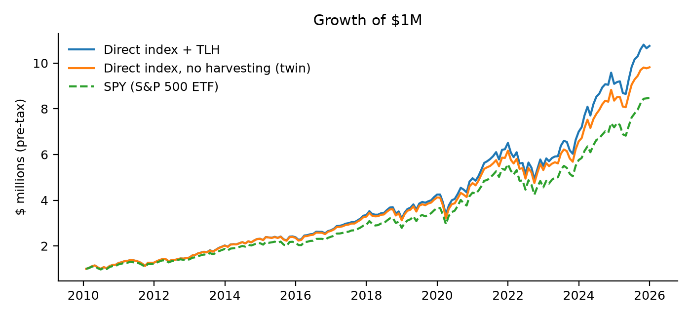
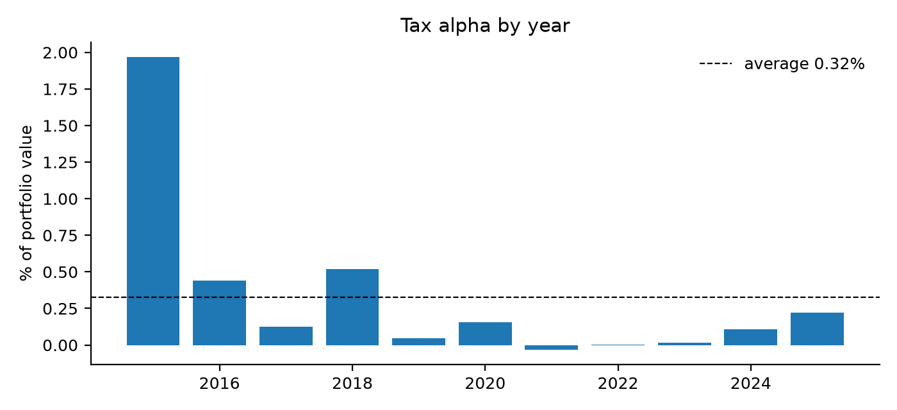
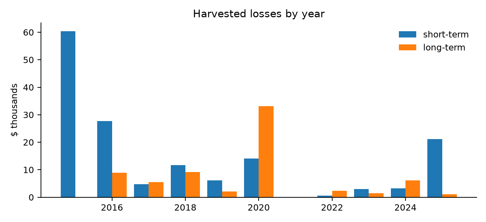
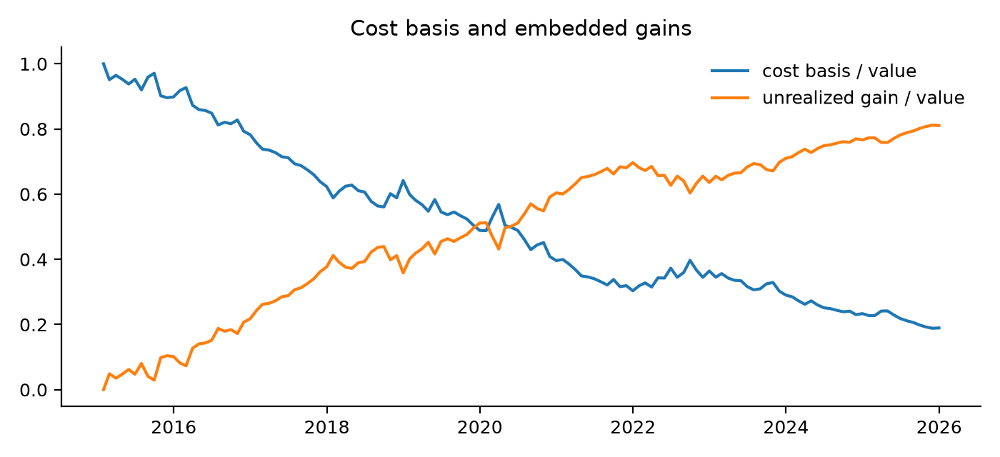

# Summary

I built a direct-indexed S&P 500 portfolio from $1 million of cash, tracked every tax lot, and harvested losses with a rule-based strategy that respects the 30-day wash-sale rule. I backtested it monthly from January 2015 to December 2025 against an identical portfolio that never harvests (the "twin"), so the only difference between the two is the harvesting.

| Headline (2015–2025, $1M start) | Result |
|---|---|
| Tax alpha, average per year (definition in §3.5) | **0.32%** of portfolio value |
| Tax alpha, first 5 years / last 5 years | 0.62% / 0.06% |
| Harvested losses, short-term / long-term | $152,674 / $69,955 |
| Tax saved vs the twin, total | $50,955 |
| Tracking error vs the twin / vs SPY | 1.48% / 1.89% per year |
| Pre-tax return vs the twin | −0.22% per year |
| One-way turnover / trading costs | 16.7% per year / $2,996 in total |

The pattern is the main finding. Harvesting is worth most in the **first years**, when cost bases are close to market prices; as the market rises, embedded gains build up (81% of the portfolio's value by 2025) and opportunities dry up. Most of the benefit is a **deferral**: lower cost bases mean larger gains later, which the backtest makes visible.

# 1 · Background

**Direct indexing** means holding the individual stocks of an index in a separately managed account instead of buying a fund that tracks it. The investor owns each position and each tax lot, so the account can be customised (exclusions, tilts) and, most importantly here, each stock's gains and losses can be managed separately.

**Tax-loss harvesting (TLH)** sells a position that trades below its purchase price to *realize* the loss, and immediately buys a similar security so that market exposure is kept. The realized loss offsets realized gains elsewhere: short-term losses first offset short-term gains (taxed as ordinary income), long-term losses offset long-term gains, the two then net against each other, up to $3,000 of any remaining net loss offsets ordinary income each year, and the rest carries forward with no expiry.

**Why direct indexing harvests more than a fund.** A fund is one position: in a year when the index rises it has nothing to harvest. Inside the index, single stocks are spread out (dispersion): even in an up year many constituents are below the price at which they were bought, and each one can be harvested on its own.

**The wash-sale rule** disallows a loss if the same (or a "substantially identical") security is bought within 30 days before or after the sale. Replacement securities must therefore be different but similar, and the original can only be bought back after the window.

**Deferral, not elimination.** The replacement is bought at a lower price, so the new cost basis is lower and the future gain is larger. Harvesting therefore mostly *delays* tax. It adds value through (i) the time value of the deferred tax, (ii) rate arbitrage when a short-term loss (up to 40.8%) offsets tax that comes back later as a long-term gain (23.8%), and (iii) permanence if the shares are never sold (the cost basis steps up at death, or the shares are donated).

# 2 · Data, universe and backtest period

**Universe and benchmark.** The S&P 500, held as individual stocks at **market-cap weights**. Membership is **point-in-time**: on every date the portfolio may only hold stocks that were index members on that date, taken from the public `fja05680/sp500` dataset (the full member list on every change date since 1996). Using today's member list would bias returns upward and also hide exactly the stocks that fell hardest, i.e. the losses a harvesting strategy would have taken.

**Prices.** Daily prices from Yahoo Finance (via `yfinance`), adjusted for splits and dividends, so returns are total returns with dividends reinvested. Month-end prices drive the backtest; daily returns are used only to choose replacement stocks.

**Market caps.** Cap = split-adjusted close × each stock's latest shares outstanding (both from Yahoo), so price and share count are in the same split basis. Yahoo's historical share counts are in the pre-split basis (e.g. GE before its 1-for-8 reverse split, NVIDIA before its 4-for-1 and 10-for-1 splits), and mixing the two bases inflated GE's 2015 weight eightfold in an early version. The cost of the fix is that buybacks and share issuance over time are ignored.

**Period.** January 2015 to December 2025: 11 full tax years covering the 2015–16 selloff, the Q4 2018 drawdown, the COVID crash of 2020, the 2022 bear market and the 2023–25 rally. Yahoo's share history is thin before 2015, which set the start date.

**Coverage.** Yahoo has prices for 618 of the 853 stocks that were S&P 500 members between 2009 and 2025. Priced members are 72% of the index in January 2015, rising to 98% in 2025 (86% on average). The missing names are mostly delisted, acquired or renamed companies, so **residual survivorship bias remains**; its visible symptom is that the no-harvest twin outperforms SPY by about 1.1% a year (14.96% vs 13.84%).

**Assumptions.** Short-term tax rate 40.8% and long-term 23.8% (top federal rates plus the 3.8% net investment income tax; no state tax). The investor has enough gains elsewhere to use every realized loss in the year it is taken, at the rate of its own character; taxes are paid from outside the account. Trading cost 5 bps of traded value per side (commissions are zero; this covers half the bid-ask spread of large US stocks plus some market impact). Dividends are reinvested and their tax is ignored, identically for both portfolios.

# 3 · Methodology

## 3.1 Portfolio construction
On 31 January 2015 the $1M of cash buys every priced member at its market-cap weight. The portfolio is then **buy-and-hold**: cap weights drift with prices exactly as the index does, so no rebalancing trades (and no realized gains) are needed to stay close to it. On each month-end:

1. **Index exits and delistings**: every lot of a stock that left the index is sold (its last traded price is used if it stopped trading).
2. **Index entries**: each new member is bought at its cap weight, funded by the exit proceeds.
3. **Swap-backs** (§3.4).
4. **Harvesting** (§3.3).

## 3.2 Tax lots
Every purchase creates a lot: purchase date, shares and cost basis per share. A lot is **short-term** if sold within 365 days of purchase and **long-term** otherwise. Sales identify specific lots: the harvest rule sells exactly the lots that are under water, and full sales go highest-cost-first (**HIFO**), which realizes the smallest gains first. Every sale records its realized short- and long-term gain or loss.

## 3.3 Harvesting rule
A lot is harvested when its price is **at least 10% below its cost basis**. The trigger sits well above the round-trip cost (sell, buy, swap back and sell again: about 20 bps plus the replacement's likely drift), so small dips are left alone. A stock is skipped if it was bought in the previous 30 days, because that purchase would wash the loss. Only the losing lots are sold; lots of the same stock that carry gains are kept.

**Replacement.** The proceeds buy the index member with the **highest correlation** to the harvested stock over the previous 252 trading days (e.g. KLA for a semiconductor), excluding any stock that was itself sold at a loss in the last 30 days. Choosing from inside the index keeps the portfolio's exposures close to the benchmark.

## 3.4 Drift control: swap back after 31 days
After the wash-sale window, the replacement lots are sold and the original stock is bought back, so the portfolio returns to its index weights. This always happens, even when the replacement has risen and the swap realizes a short-term gain. An early version kept the replacement whenever it had risen more than 5% to avoid that tax; in an equal-weighted test that rule replaced NVIDIA with KLA early in the decade and never bought it back, and NVIDIA's later rise alone produced a $1.65 million shortfall against the twin. Unbounded drift is the larger risk, so the main case always swaps back; the "keep" rule is shown as a sensitivity.

## 3.5 Benchmark and measurement
- **The twin** runs the same code with harvesting switched off: same universe, weights, index changes and costs. Pre-tax alpha, tracking error and tax alpha are measured against it, which isolates the effect of harvesting.
- **SPY** (the S&P 500 ETF, total return) is shown for context; the gap to SPY reflects data and weighting limits rather than the strategy.
- **Tracking error**: annualised standard deviation of monthly (portfolio − benchmark) returns. Realized only; no risk model is used, so no ex-ante figure is reported.
- **Tax alpha (my definition):** for each year, the tax the twin owes minus the tax the TLH portfolio owes, divided by the TLH portfolio's average value that year. Taxes are computed from realized short- and long-term gains and losses at the rates above. Because both portfolios realize gains when stocks leave the index, the measure is net of the deferred gains that come back inside the window.

# 4 · Results

## 4.1 Returns and tracking

{width=85%}

| 2015–2025 | Direct index + TLH | Twin (no harvesting) | SPY |
|---|---|---|---|
| Annual return (pre-tax) | 14.67% | 14.96% | 13.84% |
| Volatility | 14.73% | | |
| Pre-tax alpha vs twin / vs SPY | −0.22% / +0.70% per year | | |
| Tracking error vs twin / vs SPY | 1.48% / 1.89% per year | | |
| Average holdings | 420 | | |
| One-way turnover | 16.7% per year (twin: index changes only) | | |
| Trading costs | $2,996 total | | |

Harvesting cost 0.22% a year of pre-tax return against the twin. This is the replacement drift during the 31-day windows: over 11 years it is within one tracking error and is not a systematic cost, but it is the price paid for the tax benefit.

## 4.2 Tax alpha and harvested losses

{width=80%}

{width=80%}

Tax alpha averages **0.32% a year**, but almost all of it comes early: **1.97% in 2015** (the first year, when every cost basis is close to the price and the August 2015 selloff pushed many lots under water), 0.52% in 2018, and close to zero in 2021–2023. Strikingly, the 2022 bear market produced almost nothing: by then the lots had been bought years earlier at much lower prices, so even an 18% fall left most of them above cost.

The 937 harvest sales realized **$152,674 of short-term and $69,955 of long-term losses**. Two things give part of it back inside the window:

- **Swap-backs realized $53,656 of short-term gains** (35% of the short-term losses), because the replacement usually rose a little during its 31 days.
- **Index exits realized $15,550 of long-term gains for TLH against a $9,502 loss for the twin**: the lower cost bases created by harvesting coming due, i.e. the deferral made visible.

Net, the TLH portfolio paid **$50,955 less tax** than the twin over 11 years on a $1M start.

## 4.3 Cost basis and holdings

{width=80%}

By 2025, unrealized gains are **81% of portfolio value**. This is why harvesting decays: a lot can only be harvested if it falls below its cost, and after a decade of gains almost no lot can. Fresh opportunities come only from new lots: new money, index entrants and swap-backs.

The portfolio holds 342 stocks in 2015, rising to 486 in 2025, tracking the number of priced index members; every stock in the index is held except during its 31-day swap window.

**After-tax, if liquidated in December 2025** (paying long-term tax on all remaining gains), the TLH portfolio is worth **$3.65M** and the twin **$3.73M**. The pre-tax drift (−2.8% over 11 years) outweighs the tax saved once every deferred gain is paid. The benefit of TLH therefore depends on the investor *not* liquidating: holding on, giving shares to charity, or the step-up at death.

## 4.4 Sensitivity

| Case | Tax alpha / yr | Pre-tax alpha vs twin | Tracking error vs twin | Turnover / yr |
|---|---|---|---|---|
| Trigger 5% | 0.34% | +0.20% | 1.08% | 25.6% |
| **Trigger 10% (main)** | **0.32%** | **−0.22%** | **1.48%** | **16.7%** |
| Trigger 15% | 0.30% | +0.03% | 0.33% | 8.7% |
| 10%, keep replacement if up >5% | 0.36% | −0.34% | 1.33% | 8.7% |

Lowering the trigger from 15% to 5% adds only 0.04% of tax alpha a year while tripling turnover: most of the benefit comes from large drawdowns, which every trigger catches. The 15% trigger has the lowest tracking error and nearly the same tax alpha, which makes it the better choice for an investor who cares about staying close to the index. Keeping replacements avoids the swap-back gains (higher tax alpha) but lets the portfolio drift from the index; its pre-tax cost is the largest.

# 5 · Conclusions

**The takeaway.** The aim was to build the whole mechanism end to end (tax lots, the harvesting trigger, the wash-sale rule in both directions, replacement and swap-back, and a tax alpha measured against a twin that never harvests), so the same engine could run on a real account. Its main lesson is that the value is real but front-loaded and mostly a deferral, and that the details (when to harvest, how fast to return to the index) decide whether it helps.

**Pros of direct indexing.** Each stock is its own tax lot, so losses can be harvested in years when the index is up. The account can be customised (exclusions, ESG screens, tilts, offsetting a concentrated position), and at institutional size trading costs are small: under $3,000 here over 11 years.

**Value added for investors.** The value is largest for (i) investors with large realized gains elsewhere (a business sale, concentrated stock, active managers distributing gains), who can use short-term losses at up to 40.8%; (ii) new accounts and new money, because harvesting is front-loaded; and (iii) investors who will not liquidate, so the deferral becomes permanent through charitable giving or the step-up at death.

**Cons and risks.** The benefit decays as gains build up, and periodic new cash is needed to renew it. It is mostly a deferral: on liquidation, the result here turns negative. Replacements add tracking error, and holding a replacement too long can miss a winner (the NVIDIA example). The wash-sale rule applies across all of the client's accounts (an IRA, a spouse's account, a dividend reinvestment plan), which a single-account model cannot see. Losses are only valuable if the investor has gains to offset.

**Limits of this backtest.**

- **Survivorship:** 28% of index members had no Yahoo price in 2015, falling to 2% by 2025; the twin beating SPY by 1.1% a year is the symptom.
- **Weights:** caps use the latest share count, so buybacks and issuance are ignored, and the portfolio is not rebalanced for them.
- **Frequency:** checks are monthly; daily monitoring would catch dips that recover within a month, so tax alpha is understated relative to practice.
- **Taxes:** a flat top rate, no state tax, losses always fully usable, dividend tax ignored, no $3,000 limit.
- **Window:** 2015–2025 was mostly a rising market; a period starting before a deep drawdown would show more harvesting.

# 6 · Next steps

1. **Data:** rerun on CRSP via WRDS (point-in-time members, delisted returns, historical shares outstanding) or Bloomberg, to remove the survivorship gap and use true historical caps.
2. **Daily harvesting checks** and a volatility-scaled trigger (a bigger drop required for volatile stocks).
3. **Better replacements:** a factor risk model to pick replacements and report ex-ante tracking error, or a basket of two or three correlated stocks instead of one.
4. **Tax-aware optimisation** in the spirit of Moehle, Kochenderfer, Boyd and Ang (2021): trade off tax savings against tracking error in one objective instead of fixed rules.
5. **Cash flows:** monthly contributions, which renew harvesting opportunities, and a capped $3,000 / carry-forward treatment of net losses.
6. **Longer and harder windows**, e.g. starting in 2000 or 2007.

# 7 · Note on AI tools

I used Claude (Anthropic), through Claude Code, as a pair programmer and writing assistant. It wrote first versions of the data, engine and metrics code in small pieces, which I reviewed step by step; it helped diagnose two bugs (the "keep replacement" drift that missed NVIDIA, and the mixed split basis that over-weighted GE); and it drafted this report from the backtest outputs, which I edited. Design choices (point-in-time membership, market-cap weights, always swapping back, the trigger level) were made in that discussion, and I can explain each line of the code.

---
*Code and instructions to reproduce: see the README in the repository. All figures and tables are produced by `analyze.py`.*
